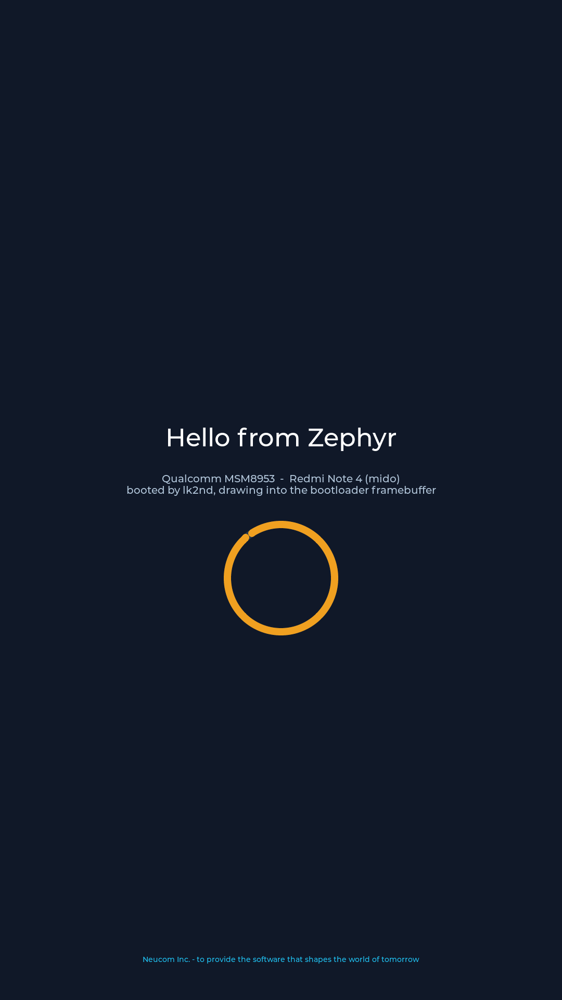

# Zephyr + LVGL on a Redmi Note 4 (MSM8953), booted by lk2nd

Zephyr RTOS running on a phone that already boots postmarketOS through
[lk2nd](https://github.com/msm8916-mainline/lk2nd), drawing an LVGL screen by
rendering straight into the framebuffer the *bootloader* is still scanning out.

No DSI driver, no panel init sequence, no PLL programming, no kernel. lk2nd
loads this image exactly the way it loads Linux - as an ARM64 Android boot
image with an appended device tree, handed over from TrustZone into non-secure
EL1 with `x0` pointing at the DTB - and Zephyr takes it from there.

```
lk2nd  ──fastboot boot boot.img──▶  zephyr.bin (ARM64 Image, + mido DTB)
                                       │
                                       ├─ soc/qcom/msm8953   CPU, GIC-400, arch timer, MMU, x0 hook
                                       ├─ drivers/serial     UARTDM console on the UART lk2nd used
                                       ├─ drivers/display    MDP5 continuous-splash framebuffer
                                       └─ app                LVGL UI into that framebuffer
```

## Status

Works, as far as can be checked without flashing: the image builds, and
everything below the point where hardware has to answer is verified (see
[Verification](#verification)). **The target has not been run on physical
hardware by me** - I have no mido here. What that means for the first flash is
in [Honest risk list](#honest-risk-list).

| Piece | State |
| --- | --- |
| Builds to an lk2nd-loadable `boot.img` | yes, `prebuilt/boot.img` |
| Boot chain replayed against lk2nd's own rules | 20/20 checks, `tools/verify_boot.py` |
| Display driver + LVGL glue + blit, executed | 10/10 checks, `native_sim` render |
| Executes end to end under an emulated A53, and paints the UI into the bootloader's surface | 6/6, `tools/emulate_boot.py` |
| Console on `ttyMSM0` @ 115200 | writes verified in emulation, untested on hardware |
| GIC-400 + ARM generic timer interrupts | programmed, but no IRQ delivery in the emulator |
| Wi-Fi, modem, touch, USB, storage | not attempted |

## Compatibility matrix

| Board | Support level |
| --- | --- |
| Xiaomi Redmi Note 4X (mido), MSM8953 | Primary - the only target |
| Xiaomi Redmi Note 4 (mido, MTK variant) | Unsupported - different SoC entirely |
| Other MSM8953 devices (vince, tissot, daisy...) | Untested - same SoC, different panel/UART, would need a board entry |
| `native_sim` (host) | Secondary - used for the render check |

## What "plop over drivers from Linux" ended up meaning

The interesting reduction is on the display side. Porting `drm/msm` (MDSS +
DSI + PHY + a panel driver) is thousands of lines and needs the panel's init
sequence and the DSI timing tables. But none of that is ours to do: by the time
we run, the stock bootloader has already brought the panel up and left the MDP5
pipe scanning out a framebuffer, and lk2nd deliberately keeps it running
(`cont-splash`) so Linux has something on screen during boot.

So the port is the *cheap* half of `drm/msm/mdp/mdp5` - read back the SSPP
registers that describe the surface:

| Register | Meaning |
| --- | --- |
| `SSPP_SRC0_ADDR` (0x14) | which surface the pipe is fetching |
| `SSPP_SRC_IMG_SIZE` (0x04) | resolution |
| `SSPP_SRC_YSTRIDE` (0x24) | stride in bytes |
| `SSPP_SRC_FORMAT` (0x30) | pixel format, `bpp = ((fmt >> 9) & 3) + 1` |

...then write pixels into that memory. Same trick as `lk2nd/display/cont-splash/pipe.c`
(which itself comes from Linux), and the same thing DRM's simple-framebuffer
handoff does. On mido the surface is `0x90001000`, 1080x1920, stride 3240,
`r8g8b8`.

Two independent sources are used, so it works even if one is missing:

1. the runtime device tree in `x0` - lk2nd injects/refreshes a
   `simple-framebuffer` node there when the kernel cmdline carries
   `lk2nd.pass-simplefb`; `lib/fdt_min.c` reads it;
2. the MDP5 registers themselves, if the DT says nothing.

The framebuffer is mapped on demand (`arch_mem_map()`) once its address is
known; it cannot be a static MMU region because neither the address nor the
size is a compile-time constant.

The one non-obvious requirement: the MDP must be left in self-refreshing mode,
otherwise it fetches the frame once and never again, and the screen freezes on
whatever was in memory. `lk2nd.pass-simplefb=autorefresh` is what enables it -
that is why the cmdline is not optional.

## Building

```sh
# toolchain: Zephyr SDK 1.0.x (`west sdk install`), CMake, Ninja, Python 3.12+
west init -l app && west update          # or: pixi run init && pixi run update
west build -d app/build -b mido app      # or: pixi run build
```

`app/CMakeLists.txt` registers this repository as the board root, SoC root, DTS
root and as a Zephyr module, so a plain `cmake -B build -DBOARD=mido app`
works too.

Produce the bootable image:

```sh
pixi run image
# equivalently:
python tools/mkbootimg.py \
    --kernel app/build/zephyr/zephyr.bin \
    --dtb prebuilt/msm8953-xiaomi-mido.dtb \
    --cmdline "lk2nd.pass-simplefb=autorefresh console=ttyMSM0,115200n8" \
    -o prebuilt/boot.img
```

`prebuilt/boot.img` is committed, so flashing does not require a build. It is
the exact image `tools/verify_boot.py` was run against.

## Flashing

mido must already have lk2nd (it does, if postmarketOS boots) and an unlocked
bootloader. The image boots **from RAM only** - it does not touch flash, so
nothing you have installed is modified and there is nothing to undo except
rebooting.

```sh
# phone: power + volume-down into lk2nd's fastboot, then:
fastboot boot prebuilt/boot.img
```

`fastboot boot` (not `flash boot`) is deliberate: the image is downloaded into
memory and jumped to. Power-cycle the phone and postmarketOS comes back
untouched. If you do want it in flash, `fastboot flash boot prebuilt/boot.img`
overwrites postmarketOS's boot image - reinstall postmarketOS (or restore its
`boot.img`) to get back.

### Watching it

UART is on the phone's debug pads (BLSP1 UART0, `0x78AF000`, 115200 8N1) - the
same one lk2nd prints on, so if you can see lk2nd's menu over the pads you can
see this. Expect:

```
*** Booting Zephyr OS build 4.5.0 ***
*** Zephyr on mido (MSM8953) ***
runtime DTB from bootloader: 0x83400000
display: 1080x1920, 32 bpp, format 8
LVGL up, entering handler loop
```

and, on screen, a dark background, "Hello from Zephyr", a spinning orange arc
and a footer. `fastboot oem log` / the UART also show the driver's probe line:

```
display_mdp5: framebuffer 0x90001000 1080x1920 stride 3240 bpp 3 via dtb (simplefb)
```

That line is the whole port in one place: it tells you which surface the
bootloader is scanning out and how the driver found it.

## Verification

Three things are checked mechanically, because "it compiles" is not evidence.

### 1. Boot chain replay - `tools/verify_boot.py`

Reimplements what lk2nd does to this image and asserts every assumption holds.
The interesting one: lk2nd on msm8953 is built with
`ABOOT_IGNORE_BOOT_HEADER_ADDRS`, so the load address in the boot header is
**ignored** and recomputed as

```
((DDR_START + 0x80000) & ~0x1fffff) + text_offset    # = 0x80000000 + text_offset
```

A Zephyr ARM64 image carries `text_offset = 0`, which would load it at
`0x80000000` while it is linked for `0x80080000` - an instant, silent crash.
`tools/mkbootimg.py` therefore patches `text_offset` to `0x80000`, and the
verifier checks that lk2nd's computed address equals the ELF's link address.

It also checks the appended-DTB mechanism (`dev_tree_appended()` reads a 32-bit
offset from `kernel + 0x2C`, which `mkbootimg.py` fills in), that kernel and DTB
do not collide with each other or with lk2nd's own 10 MiB at `0x8f600000`, that
every PT_LOAD segment is inside the DDR window `mmu_regions.c` maps, and that
the *actual* on-target FDT parser (compiled for the host) finds the geometry
lk2nd's `simplefb.c` would inject - using values the shipped DTB does not
contain, so a pass cannot be an accident.

```
$ pixi run verify
...
all 20 checks passed
```

### 2. Host render - `native_sim`

The same display driver, blit path and LVGL glue are built for `native_sim`
against a stand-in MDP5 register block (`tests/sim/mdp5_sim.c`) that answers
registers the way mido's bootloader would, and owns the framebuffer. The app
renders and dumps the surface:

```
$ pixi run sim-build && pixi run sim-run && pixi run sim-check
all 10 checks passed
```



The dump caught a real bug (FDT magic read natively instead of big-endian) and
a real subtlety: `x8r8g8b8` on MDP5 is `B,G,R,X` in memory, so a naive RGB dump
of a correct framebuffer looks colour-swapped.

### 3. Execution - `tools/emulate_boot.py`

The image is loaded into an emulated Cortex-A53 (unicorn) at exactly the
address lk2nd jumps to, with the mido DTB placed at the tags address and passed
in `x0`, and with the UART/GIC/MDP register blocks faked well enough to answer.
This is not a phone - there is no TrustZone and no interrupt delivery - but it
executes the real reset path, MMU setup, driver probes and application:

```
$ pixi run emulate
[00:00:16.766] <inf> display_mdp5: framebuffer 0x90001000 1080x1920 stride 3240 bpp 3 via dtb (simplefb)
*** Booting Zephyr OS build 4.5.0 ***
*** Zephyr on mido (MSM8953) ***
runtime DTB from bootloader: 0x83400000
display: 1080x1920, 24 bpp, format 1
LVGL up, entering handler loop
[ok] kernel banner reached the console
[ok] application main() reached
[ok] display driver probed a surface
[ok] LVGL initialised and the render loop was entered
[ok] pixels written through the MMU into the bootloader framebuffer
[ok] the frame actually drawn is the application UI
```

That last pair is read back out of the emulated panel memory: 2,050,186 of
2,073,600 pixels are the UI's background colour, at the address the bootloader
was using (0x90001000), reached through Zephyr's own page tables. The bytes are
`28 18 10` in memory rather than `10 18 28`, which is correct: Zephyr's
`PIXEL_FORMAT_RGB_888` is `B,G,R` in memory (`zephyr/modules/lvgl/lvgl_display_24bit.c`
says so) and so is MDP5's 24bpp RGB888 surface.

`--drop-dtb` runs the same thing with no device tree, which exercises the
MDP5-register fallback instead:

```
<wrn> display_mdp5: runtime devicetree at 0x83400000 is not a valid FDT
<inf> display_mdp5: VIG_0: src0=0x90001000 img=1080x1920 stride 3240 fmt=0x00000400 bpp=3
```

This step earned its keep - it found two bugs static analysis did not:

* the DDR MMU region was declared as one 0x80000000..0xc0000000 window, which
  overlaps the kernel image; Zephyr maps its own regions first and rejects an
  overlapping `MT_NO_OVERWRITE` region *as a whole*, so nothing was mapped and
  the first read of the runtime DTB faulted. The framebuffer is now mapped on
  demand with `arch_mem_map()` once its address is known;
* `lib/fdt_min.c` reported bits per pixel while the driver works in bytes, so
  the DT path rejected every surface ("unsupported bpp 24") and silently fell
  back to the register path.

### 4. Header sanity

```
$ aarch64-zephyr-elf-objdump -d app/build/zephyr/zephyr.elf | head -1
80080000:  1400043b   b  800810ec <__reset>
$ od -A x -t x1 -N 64 app/build/zephyr/zephyr.bin
000030  00 00 00 00 00 00 00 00  41 52 4d 64 00 00 00 00   ARM\x64 magic at 0x38
```

## Honest risk list

What is *not* verified, in the order it would bite:

1. **EL1 entry from `scm_elexec_call`.** Linux is entered the same way, and
   Zephyr's AArch64 startup handles EL1 (it writes VBAR/CPACR/SCTLR only, no
   secure registers), but I could not run it.
2. **GIC-400 from non-secure EL1.** Zephyr's GICv2 init writes `GICD_CTLR` and
   `GICC_*`; those are the non-secure-visible registers, and Linux programs the
   same ones after the same handoff. If the interrupt path were broken, the
   `tick_is_alive()` check in `app/src/main.c` prints a warning and falls back
   to polled rendering instead of hanging - so the failure is visible on screen
   and UART rather than a frozen splash.
3. **The UART.** The driver does not reprogramme anything: it trusts lk2nd's
   baud divisor and clock, exactly like lk2nd's own console, and pushes
   characters using the same `NO_CHARS_FOR_TX` protocol. If you see nothing on
   the pads, that is the first thing to look at.
4. **`x0` may not be the DTB.** Only used as the first probe; the MDP5 register
   path does not need it, so a wrong `x0` costs a log line, not a screen.
5. **The splash may be 16bpp** on a different panel variant (mido shipped five).
   The driver handles 16/24/32 bpp and picks the format from the registers.
6. **Being killed by lk2nd's own checks.** `check_ddr_addr_range_bound()` /
   `check_aboot_addr_range_overlap()` run before the jump; the verifier checks
   the same conditions the code does, but only lk2nd itself can really say yes.

## Layout

```
app/                     application: LVGL UI, prj.conf, native_sim overlay
boards/qcom/mido/        board: board.yml, mido.dts, defconfig
soc/qcom/msm8953/        SoC: Kconfig, MMU regions, x0 firmware-args hook
drivers/serial/          UARTDM console (BLSP layout, as lk2nd/Linux use it)
drivers/display/         MDP5 continuous-splash framebuffer driver
dts/bindings/            bindings for the two drivers
lib/fdt_min.c            minimal FDT walker, host-testable
tools/mkbootimg.py       Android boot image builder (text_offset + appended DTB)
tools/verify_boot.py     replays lk2nd's boot chain and checks the assumptions
tools/emulate_boot.py    executes the image on an emulated A53 with MMIO hooks
tests/host/              FDT walker harness
tests/sim/               fake MDP5 registers + render check
```

## Licence

Apache-2.0. `prebuilt/msm8953-xiaomi-mido.dtb` is a compiled device tree from
the Linux kernel source (`msm8953-mainline/linux`), GPL-2.0 OR BSD-3-Clause,
included so the image can be rebuilt without a kernel tree.
